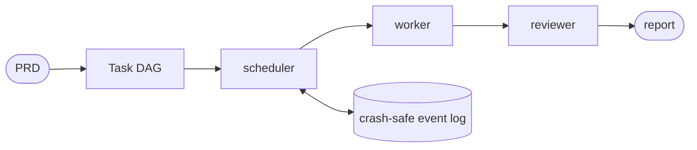

# CodeAlex

**AI Agent & LLM Infra** — I debug agents where abstractions leak.

## Merged upstream

- **NVIDIA · NeMo Agent Toolkit** — [ReAct parser swallowed JSON actions as final answers](https://github.com/NVIDIA/NeMo-Agent-Toolkit/pull/2275) · [guardrails parsed typed stream chunks as Python reprs](https://github.com/NVIDIA/NeMo-Agent-Toolkit/pull/2236)
- **NVIDIA · NeMo Agent Toolkit (ctd.)** — [guardrails middleware returned chunk reprs instead of reply text](https://github.com/NVIDIA/NeMo-Agent-Toolkit/pull/2308) · [converter matched source types with raw isinstance](https://github.com/NVIDIA/NeMo-Agent-Toolkit/pull/2310)
- **Google · ADK-JS** — [Gemini 3.5 Live Translate misrouted through the Gemini 3.x Live path](https://github.com/google/adk-js/pull/922)
- **Dify** — [strict typing for the workspace permission tests, part of the repo-wide strict Pyrefly effort](https://github.com/langgenius/dify/pull/43875)
- **ByteDance · DeerFlow** — [skill scanner matched fork bombs by spelling, so renamed and respaced payloads passed the blocking gate](https://github.com/bytedance/deer-flow/pull/6689)
- **AWS · Strands Agents** — [structured-output retry preempted by provider-native tools](https://github.com/strands-agents/harness-sdk/pull/4263)
- **morluto/rea** — [packaged platform check accepted overview responses without a procedure count](https://github.com/morluto/rea/pull/2936)

## In review

- **Kubernetes SIG · Cluster API** — [KCP propagates `DNS.imageRepository` when updating the kubeadm config map](https://github.com/kubernetes-sigs/cluster-api/pull/14301)
- **Prometheus · procfs** — [arm64 CPU identity fields: implementer / variant / part / revision](https://github.com/prometheus/procfs/pull/876)
- **NVIDIA · NeMo Agent Toolkit** — [union targets in `DecomposedType.is_subtype`](https://github.com/NVIDIA/NeMo-Agent-Toolkit/pull/2309)
- **Agent Router** — [redact error response bodies per OpenInference TraceConfig](https://github.com/theagentrouter/agent-router/pull/2730)

## Projects

### [AgentCorp](https://github.com/CodeAlex52/AgentCorp) — crash-recoverable multi-agent orchestrator

`310 offline tests` · `SIGKILL-safe resume` · `budget hard-stops` · `replayable event log`

### [agent-loop-trace](https://github.com/CodeAlex52/agent-loop-trace) — agent loop bugs → single-file timeline

<a href="https://github.com/search?q=is%3Apr+author%3ACodeAlex52+is%3Amerged&type=pullrequests">Merged PRs</a> · <a href="https://github.com/search?q=is%3Apr+author%3ACodeAlex52&type=pullrequests">All pull requests →</a>

